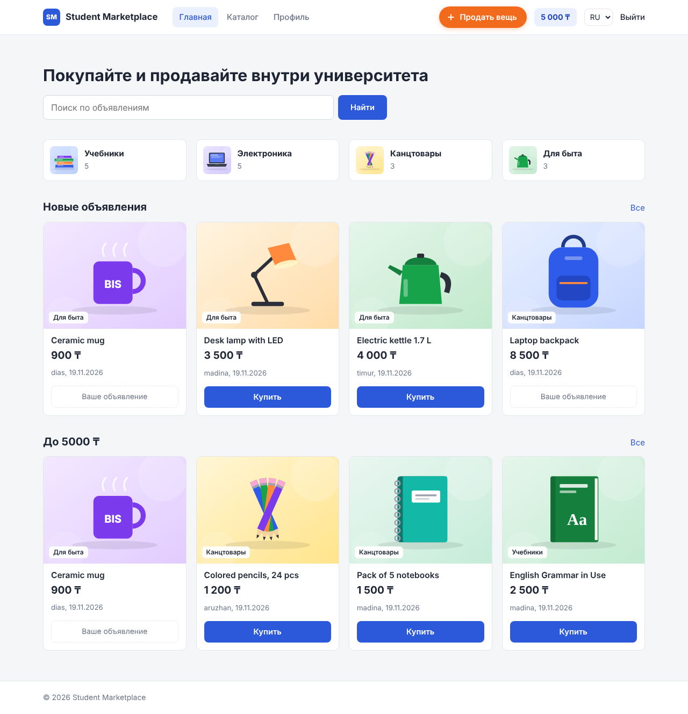

# Student Marketplace (BIS)

Маркетплейс для студентов: объявления, покупка с внутренним балансом, профиль, отзывы о продавцах.

Django 6.1 · PostgreSQL · EN / RU / KK



## Возможности

- Каталог с поиском, фильтром по категории и цене, сортировкой
- Покупка в один клик: у каждого нового пользователя на балансе 10 000 ₸, деньги переходят от покупателя к продавцу
- Профиль: баланс, активные и проданные объявления, история покупок
- Отзывы о продавце после покупки (один отзыв на одну покупку)
- Гости видят объявления размытыми, купить можно только после входа

## Запуск локально

### Docker

```bash
docker compose up
```

Сайт: http://localhost:8000

### Без Docker

Нужны Python 3.12+ и PostgreSQL.

```sql
CREATE DATABASE student_marketplace_db;
```

Windows: `run.bat`, macOS/Linux: `bash run.sh`. При первом запуске создастся `.env`. Впишите в него пароль от PostgreSQL и запустите скрипт ещё раз.

Вручную:

```bash
python -m venv venv
venv\Scripts\activate              # macOS/Linux: source venv/bin/activate
pip install -r requirements.txt
copy .env.example .env             # macOS/Linux: cp .env.example .env
python manage.py migrate
python manage.py seed_demo
python manage.py runserver
```

Без PostgreSQL: добавьте в `.env` строку `DJANGO_DB=sqlite`.

### Тестовые аккаунты

Команда `seed_demo` создаёт категории, объявления и пользователей. Повторный запуск ничего не дублирует.

| Логин | Пароль |
|---|---|
| `aruzhan`, `dias`, `madina`, `timur` | `Demo12345!` |

## Тесты

```bash
python manage.py test marketplace
```

## Запуск на сервере

```bash
sh start.sh
```

Скрипт применяет миграции, собирает статику, загружает стартовые данные и запускает gunicorn на порту `80` (или `$PORT`).

| Переменная | Значение |
|---|---|
| `DJANGO_SECRET_KEY` | длинная случайная строка |
| `DJANGO_ALLOWED_HOSTS` | домен сайта, например `market.example.kz` |
| `POSTGRES_HOST`, `POSTGRES_PORT`, `POSTGRES_DB`, `POSTGRES_USER`, `POSTGRES_PASSWORD` | подключение к PostgreSQL |
| `DEMO_PASSWORD` | необязательно: пароль тестовых пользователей |

Без PostgreSQL: `DJANGO_DB=sqlite` и `SQLITE_PATH=/путь/к/db.sqlite3`.

## Переводы

Файлы перевода лежат в `locale/`. После изменения текстов в шаблонах:

```bash
python manage.py makemessages -l ru -l kk
python manage.py compilemessages
```

На Windows для этих команд нужен GNU gettext.

## Структура

```
config/                    настройки, маршруты
marketplace/
  models.py                User, Category, ItemListing, Transaction, Review
  services.py              покупка и отзывы
  views.py, forms.py, urls.py
  templates/marketplace/   шаблоны
  static/marketplace/      css, js, картинки
  management/commands/     seed_demo, check_transactions
locale/                    переводы ru, kk
start.sh                   запуск на сервере
Dockerfile, docker-compose.yml
```
