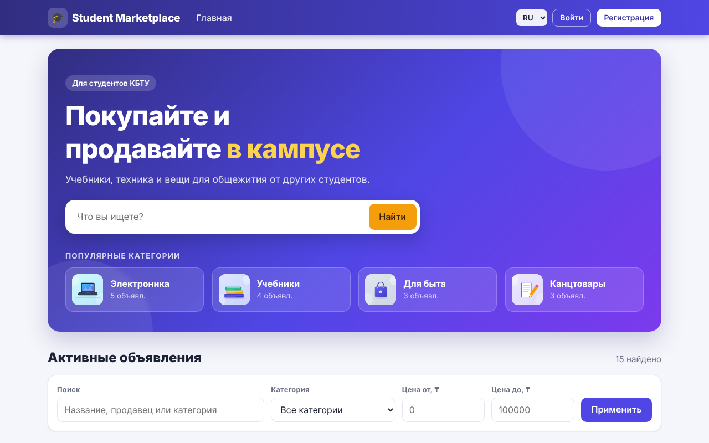
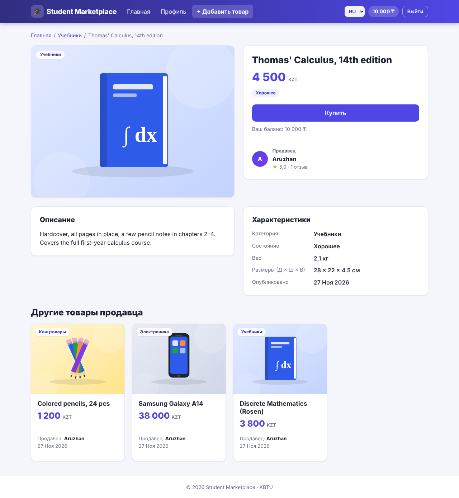
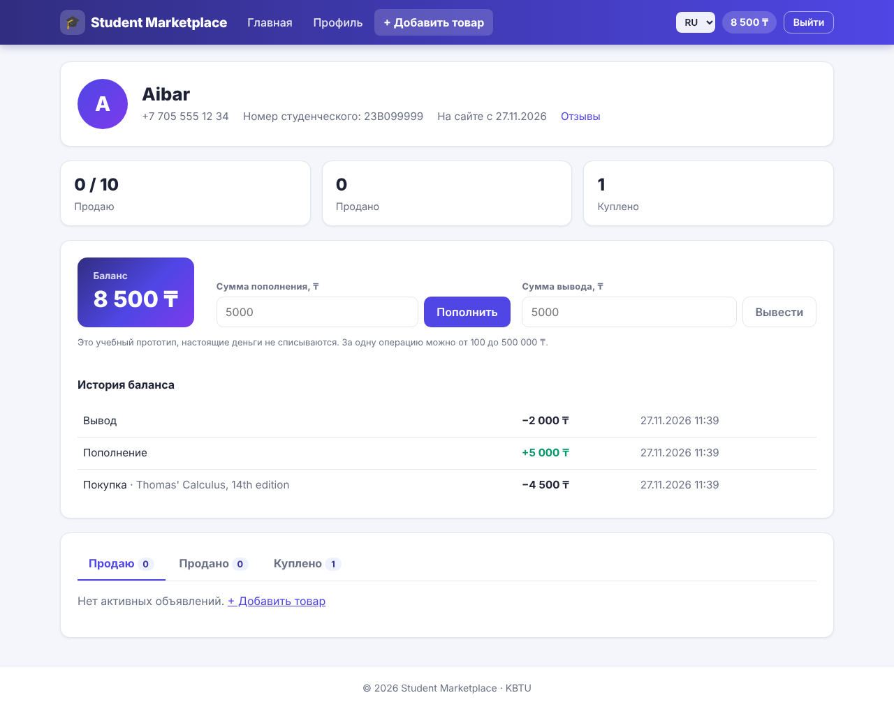

# Student Marketplace (BIS)

Маркетплейс для студентов: объявления с описанием и характеристиками, покупка с внутренним балансом, вход по номеру телефона, профиль, отзывы о продавцах.

Django 6.1 · PostgreSQL · EN / RU / KK



## Возможности

- Регистрация и вход по номеру телефона с кодом подтверждения (прототип: SMS не отправляется, код показывается на странице)
- Каталог с поиском и фильтром по категории и цене
- Страница товара: описание и характеристики (состояние, вес, размеры) — обязательны при добавлении
- Покупка: у каждого нового пользователя на балансе 10 000 ₸, деньги переходят от покупателя к продавцу
- Баланс можно пополнить и вывести, все операции видны в истории
- Профиль: номер телефона, товары на продаже, проданные и купленные
- Отзывы о продавце после покупки (один отзыв на одну покупку)
- Гости видят объявления размытыми, купить можно только после входа

| | |
|---|---|
|  |  |

## Запуск локально

### Docker

```bash
docker compose up
```

Сайт: http://localhost:8000

### Без Docker

Нужны Python 3.12+ и PostgreSQL.

```sql
CREATE DATABASE student_marketplace_db;
```

Windows: `run.bat`, macOS/Linux: `bash run.sh`. При первом запуске создастся `.env`. Впишите в него пароль от PostgreSQL и запустите скрипт ещё раз.

Вручную:

```bash
python -m venv venv
venv\Scripts\activate              # macOS/Linux: source venv/bin/activate
pip install -r requirements.txt
copy .env.example .env             # macOS/Linux: cp .env.example .env
python manage.py migrate
python manage.py seed_demo
python manage.py runserver
```

Без PostgreSQL: добавьте в `.env` строку `DJANGO_DB=sqlite`.

### Тестовые аккаунты

Команда `seed_demo` создаёт категории, объявления и пользователей. Повторный запуск ничего не дублирует.

Вход по номеру телефона, код показывается на странице ввода кода:

| Пользователь | Телефон |
|---|---|
| Aruzhan | `+7 701 000 00 01` |
| Dias | `+7 701 000 00 02` |
| Madina | `+7 701 000 00 03` |
| Timur | `+7 701 000 00 04` |

Чтобы скрыть код (например, при подключении настоящих SMS), задайте `PHONE_AUTH_DEMO=False`. Код отправляется в `marketplace/phone_auth.py` → `start_verification`.

## Тесты

```bash
python manage.py test marketplace
```

## Запуск на сервере

```bash
sh start.sh
```

Скрипт применяет миграции, собирает статику, загружает стартовые данные и запускает gunicorn на порту `80` (или `$PORT`).

| Переменная | Значение |
|---|---|
| `DJANGO_SECRET_KEY` | длинная случайная строка |
| `DJANGO_ALLOWED_HOSTS` | домен сайта, например `market.example.kz` |
| `POSTGRES_HOST`, `POSTGRES_PORT`, `POSTGRES_DB`, `POSTGRES_USER`, `POSTGRES_PASSWORD` | подключение к PostgreSQL |
| `PHONE_AUTH_DEMO` | `True` — показывать код на странице (по умолчанию), `False` — скрыть |

Без PostgreSQL: `DJANGO_DB=sqlite` и `SQLITE_PATH=/путь/к/db.sqlite3`.

## Переводы

Файлы перевода лежат в `locale/`. После изменения текстов в шаблонах:

```bash
python manage.py makemessages -l ru -l kk
python manage.py compilemessages
```

На Windows для этих команд нужен GNU gettext.

## Структура

```
config/                    настройки, маршруты
marketplace/
  models.py                User, Category, ItemListing, Transaction, Review
  services.py              покупка и отзывы
  views.py, forms.py, urls.py
  templates/marketplace/   шаблоны
  static/marketplace/      css, js, картинки
  management/commands/     seed_demo, check_transactions
locale/                    переводы ru, kk
start.sh                   запуск на сервере
Dockerfile, docker-compose.yml
```
